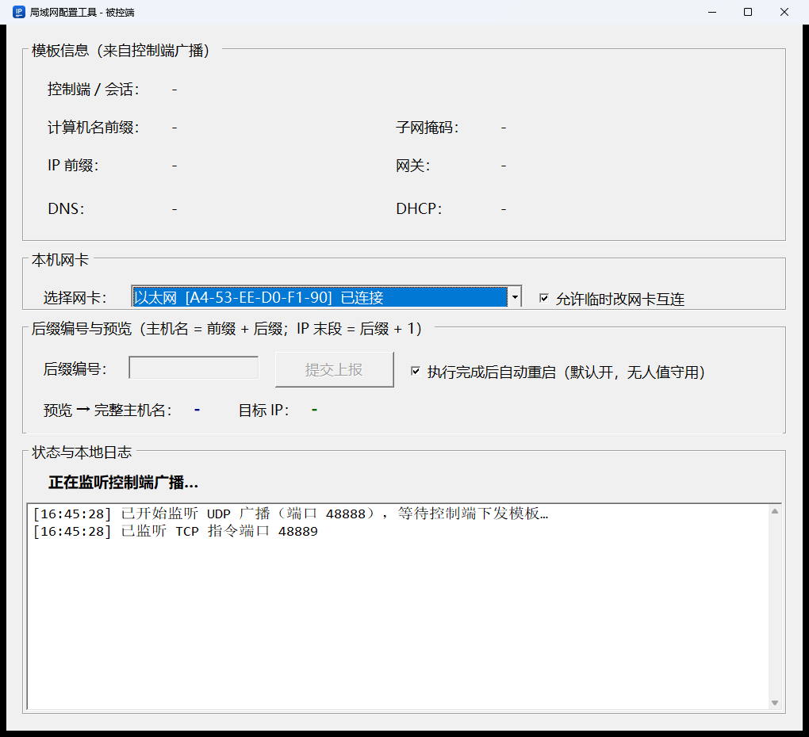

# LanAutoConfig — 局域网 PC 批量更名 & IP 配置工具

控制端 / 被控端拆分为 **两个独立程序**，面向机房批量装机、工位批量部署 Windows 终端。

- **技术栈**：C# / .NET 6 WinForms，SQLite（控制端日志），UDP 广播发现 + TCP 可靠传输，本地 PowerShell 修改网卡与计算机名
- **产物**：两个单文件独立 exe（内置 .NET 6 运行时 + SQLite，无需目标机安装运行时），Windows 10/11 / Server2016+
  - 控制端：`bin\master\局域网配置工具-控制端.exe`
  - 被控端：`bin\slave\局域网配置工具-被控端.exe`
  - 精简版（体积小，需目标机装 .NET 6 桌面运行时）：`bin\master-slim\局域网配置工具-控制端-精简版.exe`、`bin\slave-slim\局域网配置工具-被控端-精简版.exe`
- **通信**：UDP 48888（广播发现 + 模板推送），TCP 48889（上报 / 执行指令 / 结果回传）；UTF-8 JSON，MsgType + SessionId 会话隔离 + Magic/Check 校验
- **共享**：协议消息类、网络工具、校验器、AppConfig（端口/目录）、TcpSend 集中在 `Common` 类库，两端引用同一份实现，保证互通

---

## 工作模式（相比旧版的核心差异）

不是控制端一次性导入全部 IP 清单，而是 **下发前缀模板 → 被控端填后缀 → 自动拼接 → 上报待配置 → 控制端汇总审核 → 一键统一下发执行**。

核心关键点：**修改动作在被控端本地执行**（本地 PowerShell），不是控制端远程调用 CIM/WMI，规避远程 WMI/WinRM 防火墙、UAC、权限问题；不需要远程账号密码。

## 标准业务流程

1. 控制端填写模板（IP 前缀 / 掩码 / 网关 / DNS / 主机名前缀），点【开始发布模板】，每 2.5 秒 UDP 广播模板 + 会话 ID
2. 被控端（管理员运行）自动监听广播，收到模板
3. 被控端输入后缀编号，自动拼接预览完整主机名与 IP
   - **拼接规则：主机名 = 前缀 + 后缀原文；IP 末段 = 后缀编号 + 1**（后缀 `1` → `.2`，把 `.1` 留给网关；后缀 `002` → 主机名 `PC-ROOM01-002`、IP `.3`）
   - 末段为 0（网段地址）/ 255（广播地址）、等于网关、或后缀含非数字时直接拒绝并在界面上提示原因
4. 被控端【提交上报】，TCP 上报本机 MAC / 当前 IP / 目标配置
5. 控制端加入终端列表，自动做 IP、主机名冲突检测（冲突标红，禁止下发）
6. 管理员可手动修改单台目标主机名 / IP、删除终端、标记跳过
7. 确认后【下发执行命令】——**以控制端审核后的配置为准**，覆盖被控端本地预览值
8. 被控端本地执行修改网卡 IP/DNS、重命名计算机，回传结果
9. 控制端更新状态、写 SQLite 日志；被控端提示重启（可选自动重启，重启后计算机名完全生效）

## 使用

- **控制端**：直接运行 `局域网配置工具-控制端.exe`（无需管理员权限）。控制端界面提供「广播网卡(本机IP)」下拉框，可在多网卡机器上选择用哪块网卡广播模板（被控端会回连到该网卡 IP）
- **被控端**：直接运行 `局域网配置工具-被控端.exe`，**必须以管理员权限运行**（程序内会检测，无权限弹窗提示）
- 支持 DHCP 模式（模板勾选后，被控端不再拼接 IP，直接恢复 DHCP）
- 控制端黑名单（MAC/IP）拒绝指定终端上报

## 构建

一键构建（推荐，双击即可，日志写到仓库根目录 `build.log`）：

```
D:\ip\build.cmd
```

它等价于：

```bash
dotnet build LanAutoConfig.sln -c Release
dotnet publish Master/Master.csproj -c Release -r win-x64 --self-contained true -o bin\master
dotnet publish Slave/Slave.csproj -c Release -r win-x64 --self-contained true -o bin\slave
# 精简版（框架依赖，体积小，需目标机装 .NET 6 桌面运行时）
dotnet publish Master/Master.csproj -c Release -r win-x64 --self-contained false -p:SlimBuild=true -p:IncludeNativeLibrariesForSelfExtract=true -p:EnableCompressionInSingleFile=false -o bin\master-slim
dotnet publish Slave/Slave.csproj -c Release -r win-x64 --self-contained false -p:SlimBuild=true -p:IncludeNativeLibrariesForSelfExtract=true -p:EnableCompressionInSingleFile=false -o bin\slave-slim
```

产物（exe 名字已中文化，由 csproj 的 `PublishedExeName` + 发布后重命名目标完成）：

| 版本 | 文件 | 大小 | 目标机要求 |
|---|---|---|---|
| 完整版 | `bin\master\局域网配置工具-控制端.exe` | ~61.6 MB | 无（自带运行时） |
| 完整版 | `bin\slave\局域网配置工具-被控端.exe` | ~60.6 MB | 无 |
| 精简版 | `bin\master-slim\局域网配置工具-控制端-精简版.exe` | ~2.1 MB | 需 .NET 6 桌面运行时 |
| 精简版 | `bin\slave-slim\局域网配置工具-被控端-精简版.exe` | ~0.3 MB | 需 .NET 6 桌面运行时 |

**体积说明**：单文件自包含的 WinForms 应用体积下限就在这里（内置了整个 Windows 桌面运行时）。已做的优化：
- `EnableCompressionInSingleFile=true`（压缩，原本 ~150 MB）；
- `SatelliteResourceLanguages=en` 去掉其他语言的卫星程序集（约 -5.5 MB）；
- 不再打包 PDB 进 exe。

**裁剪（PublishTrimmed）走不通**：SDK 直接报 `NETSDK1175: Windows Forms is not supported or recommended with trimming enabled`，强行绕过会导致运行期反射失效，不建议。

**要更小只能用精简版**：它只含自己的代码 + `e_sqlite3.dll`，运行时用系统安装的 .NET 6 桌面运行时。目标机安装一次即可：

```powershell
winget install Microsoft.DotNet.DesktopRuntime.6
# 或下载：https://dotnet.microsoft.com/download/dotnet/6.0/runtime  （Desktop Runtime x64）
```


### 构建环境注意（CET / "Unknown Hard Error"）

.NET 9 起 `apphost`/`singlefilehost` 默认带 CET 兼容标记（`/CETCOMPAT`），**未打 CET 补丁的 Windows 上这类程序一启动就 FailFast**，表现为系统弹窗 `Unknown Hard Error` 或 `Fatal error. Your Windows doesn't fully support CET`。

- 本项目是 net6.0，产出的 exe **不受影响**；出问题的是构建工具链：`pwsh.exe`（PowerShell 7 基于 .NET 10）和 .NET 9/10 版 `dotnet.exe` 都会中招。
- 因此请用 **.NET 6 SDK** 构建（本机 `C:\Program Files\dotnet` 里就是 6.0.428，可以直接用），不要用 .NET 9/10 SDK；`build.cmd` 只走 `cmd.exe`，不依赖 pwsh。
- 两个 exe 工程已加 `<CETCompat>false</CETCompat>`，即使以后用 .NET 9+ SDK 重新构建，产出的 apphost 也不会带 CET 标记。
- 彻底修复本机：安装 Windows 更新；或在「Windows 安全中心 → 应用和浏览器控制 → 漏洞防护 → 程序设置」里给 `pwsh.exe` 关闭「硬件强制堆栈保护」；或直接用 Windows PowerShell 5.1。

## 目录结构

```
LanAutoConfig/
├── LanAutoConfig.sln             # 解决方案：Common + Master + Slave
├── app.ico                       # 程序图标（exe 资源 + 窗口/任务栏）
├── tools/make_icon.py            # 图标生成脚本（Pillow，改配色/文字后重跑即可）
├── Common/                       # 共享类库（两端共用的协议与工具）
│   ├── Common.csproj
│   ├── AppConfig.cs              # 端口/校验/目录常量、管理员检测
│   ├── NetMessages.cs            # MsgType 消息类 + JSON 序列化（协议）
│   ├── Models.cs                 # SlaveSessionItem / TemplateModel / OpLogRecord
│   ├── Validators.cs             # 后缀/主机名/IP/掩码校验
│   ├── NetworkHelper.cs          # 网卡枚举、本机 IPv4 / MAC
│   ├── TextLogger.cs             # 线程安全文本日志
│   └── TcpSend.cs                # TCP 发送（超时5s、重试1次）
├── Master/                       # 控制端独立程序（局域网配置工具-控制端.exe）
│   ├── Master.csproj / Program.cs
│   ├── MasterForm.cs             # 控制端 UI：模板/终端列表/日志 + 冲突 + 下发
│   ├── UdpBroadcastService.cs    # UDP 广播模板
│   ├── TcpServerService.cs       # TCP 接收上报/结果
│   ├── SessionManager.cs         # 会话与终端列表
│   ├── ConflictValidator.cs      # IP/主机名冲突
│   ├── SqliteLogStore.cs         # OpLog 表
│   └── Blacklist.cs              # MAC/IP 黑名单
├── Slave/                        # 被控端独立程序（局域网配置工具-被控端.exe）
│   ├── Slave.csproj / Program.cs
│   ├── SlaveForm.cs              # 被控端 UI：后缀输入/预览/上报/执行
│   ├── UdpTemplateListener.cs    # 监听广播、自动发现控制端
│   ├── TcpCommandListener.cs     # 接收执行指令/会话重置
│   ├── ConfigGenerator.cs        # 后缀 → 主机名/IP
│   └── LocalNetChanger.cs        # 本地 PowerShell：静态IP/DHCP/改名/重启
└── bin/
    ├── master\局域网配置工具-控制端.exe             # 完整版（自带运行时，~62 MB）
    ├── slave\局域网配置工具-被控端.exe
    ├── master-slim\局域网配置工具-控制端-精简版.exe  # 需 .NET 6 桌面运行时
    └── slave-slim\局域网配置工具-被控端-精简版.exe
```

## 数据与日志

- 控制端 SQLite：`%AppData%\LanAutoConfig\master_logs.db`，表 `OpLog`（SessionId / OpTime / Mac / SourceIp / TargetHostName / TargetIp / Result / ErrorMsg），支持导出 CSV
- 双方文本日志：`%AppData%\LanAutoConfig\logs\master.log` / `slave.log`
- 黑名单：`%AppData%\LanAutoConfig\blacklist.txt`
- **若 `%AppData%` 不可写**（受限令牌、安全软件拦截、只读漫游配置），上述路径自动回退到 **程序目录下的 `data\`**（如 `bin\master\data\logs\master.log`），启动日志里会标注 `（%AppData% 不可写，已回退到程序目录）`。

## 说明与偏离记录

- 文档约定“脚本调用 System.Management.Automation”。本实现为兼容**单文件自包含发布**（该 SDK 包体积大、含原生库，单文件发布麻烦），改为调用本地 `powershell.exe -EncodedCommand` 执行脚本，功能与结果等价（本地执行、无远程凭据）。若你确实需要改为 System.Management.Automation，告诉我即可切换。
- 修改计算机名仍需重启才完全生效；程序在执行成功后提示重启（可勾选自动重启）。
- 仅限同一局域网 / 工作组（域环境也兼容，仅改本机本地主机名，不做 AD 操作）；不做公网穿透、不做端口扫描、不自动抓全网主机。

## 协议与安全边界（重要）

- 协议本身**没有身份认证**：`Magic` 是公开常量，`Check` 只是 FNV-1a 明文哈希，`SessionId` 每 2.5 秒明文广播。
  因此本轮加固只做“来源约束”，不能替代真正的认证：
  - 被控端只接受**当前配对控制端 IP** 发来的指令（收到模板时记录，来源不符直接拒绝并写日志）；
  - 被控端校验指令里的 `LocalMac` 必须等于本机已上报的网卡 MAC；
  - 未收到模板（无会话）时拒绝一切指令。
  同网段的攻击者仍可嗅探 SessionId，若要真正防伪造，需要引入 HMAC 共享密钥 + 时间戳防重放（属于后续改造项）。

## 部署注意事项

- 防火墙需放行：入站 **UDP 48888**（模板广播）、入站 **TCP 48889**（上报/指令）。被防火墙拦截时的现象是“被控端一直收不到模板”。
- 两端都用 48889，**同一台机器不能同时运行控制端和被控端**（联调请用两台机器或虚拟机）。
- 控制端“广播网卡”选择哪块网卡，下发指令也从该网卡发出；被控端上报也绑定所选网卡，多网卡机器请确认选中的是接在同一局域网的那块。
- **双端必须一起更新**：本次协议升到 `LANAC-V3`（`SlaveReport` 增加硬件信息、模板/执行指令增加工作组/时区、新增心跳与重启指令），新旧版本混用会在校验处被拒绝，日志里会写 `[丢弃] ... 校验失败`。
- 程序对 `%TEMP%` / `%AppData%` 不可写的情况做了降级：`EnableVisualStyles` 失败只是失去主题外观（日志里有 WARN），数据目录自动回退到程序目录，**不会因此起不来**。如果日志里出现这两条，说明该机器上有安全软件/受限令牌在拦截这个 exe 写用户目录，建议加白名单。
- **跨网段但同一广播域可自动互通**：被控端当前 IP 与控制端不同网段（例：被控端还在 `192.168.2.5`、控制端在 `192.168.1.7`）但两台机器接在同一交换机/VLAN 时，被控端会自动**临时**给自己网卡加一个控制端网段的地址（从 `.254` 往下找空闲地址，先 ARP 探测占用），使上报/下发/回传全部走二层直连；执行配置时该临时地址随 `Remove-NetIPAddress` 一并清除，退出或重置会话时也会主动删除。
  - 控制端**不需要管理员权限**、不需要加路由。
  - 若中间有路由器/VLAN 隔离（ARP 探不到控制端），会立即回滚临时地址并提示「不在同一广播域」，这种情况只能先把被控端接到控制端网段。
  - 说明：只给被控端加静态路由的单边方案不可行——控制端的回包仍会按自己的路由表发给网关，TCP 握手完不成。

### 高 DPI / 系统缩放（125% / 150%）

Windows 把「设置 → 系统 → 屏幕 → 缩放与布局」调大后，字体按 DPI 放大，但代码里写死的像素常量（行高、控件宽高、内边距）不会跟着变，界面就会出现标签压字、控件被裁。v2.0 起由 [Common/UiScale.cs](Common/UiScale.cs) 处理：

- 程序启动时读系统 DPI（`GetDpiForSystem`），`Factor = DPI / 96`；界面构建完成后按这个比例统一换算表里布局的行列高、控件尺寸、`Padding` / `Margin` 和窗体大小；
- **100% 缩放下 `Factor = 1`，`Apply()` 直接返回**，界面与原来逐像素一致，不影响现有机器；
- 字号不缩放：`Font` 以“点”为单位，系统已经按 DPI 放大过一次，再乘就会过大；
- 缩放后窗体若超出屏幕工作区，会自动收缩到工作区内（否则标题栏跑到屏幕外，连拖都拖不回来）；内容确实放不下时窗口本身仍可缩小，只是底部日志区会被压缩。
- 调试/验证：`set LANAC_UI_SCALE=1.5` 再启动，可以在 100% 的机器上模拟 150% 的布局（此时字体也一起放大），用来在没有高分屏的环境里验证界面。



## 本次修复记录（v1.1）

功能级（会让流程失效的）：

1. **DHCP 模式修复**：`SlaveReportMsg` 增加 `IsDhcp` 并贯通 `ApplyReport`/下发/执行。此前控制端拿不到该字段，DHCP 会走成“静态 + 空 IP”，必然失败。
2. **恢复 DHCP 真正启用 DHCP**：脚本补 `Set-NetIPInterface -Dhcp Enabled`（静态配置过的网卡 EnableDHCP=0，只删地址会掉进 169.254.x.x 失联），切换后等待并校验是否拿到地址；静态模式补 `-Dhcp Disabled`。
3. **DNS2 留空不再炸**：DNS 服务器列表按非空项拼接，空 DNS2 不再把 `''` 传给 `Set-DnsClientServerAddress`（原先会导致 IP 已改完却报失败）。
4. **多网卡上报源 IP 修正**：改用“选中网卡”的 IPv4（原来用 `GetLocalIpv4()`，多网卡机器常选到虚拟网卡/APIPA，控制端会往错误 IP 下发）；`GetAdapters()` 改为物理网卡优先、跳过 APIPA、标注虚拟网卡。
5. **结果回传可靠性**：被控端改 IP/改名后网络可能短暂不可用，结果回传改为最多 3 次重试；控制端对“执行中”超过 120 秒没结果自动判失败并写库，不再永久卡在“执行中”；下发连不上时退回“待执行”（可重试）而不是直接判死。

流程与交互：

6. **「标记跳过」能解除冲突**：冲突统计排除已跳过/跳过的终端，不再出现“跳过一台后仍然禁止下发”的死锁；右键菜单改为可切换跳过 / 取消跳过。
7. **下发防重入**：新增 `_dispatching` 标志，下发过程中刷新列表不会再把该按钮点开。
8. **后台线程不再直接摸 UI**：下发/重置里的日志改走 `SafeUi`；重置会话的逐台通知移到后台线程（原先在 UI 线程同步等待 5s×N）。
9. **半启动回滚**：先起 TCP 再起 UDP，任一失败都 Stop 两端，不再出现“提示失败但端口已被占”的状态。
10. **状态栏/杂项**：`广播:` 状态实时更新；黑名单框在右键添加后刷新；「查看黑名单」用 `SelectedTab` 正确切页；删掉无用的“起始 IP 编号”输入框；终端表格改为列级只读，只有目标主机名 / 目标 IP 可编辑且**编辑即校验**。

健壮性：

11. **TCP 读行改 UTF-8 解码**：原实现逐字节 `(char)buf[0]`，只要载荷不是纯 ASCII（例如换了 JSON 编码器或非 .NET 客户端）就会破坏字节流、导致校验失败并静默丢弃；现在按字节缓冲后整体 UTF-8 解码，超长行截断。
12. **消息丢弃不再静默**：解析失败 / 校验失败 / 来源不符都会写日志并说明原因。
13. **校验收紧**：`IsValidIp` 改为严格 4 段 IPv4（不再接受 `1`、`192.168.1` 这类缩写）；主机名限 ASCII、≤15 字符、首尾不能是短横线；后缀编号 >255 给出明确提示。
14. **PowerShell 调用加固**：stdout/stderr 并发读取（原来顺序读有管道死锁风险）、60 秒超时后强制结束进程并给出明确错误；执行前对网卡 / 掩码 / 网关 / 主机名做本地校验。
15. **启动不再被用户目录“一票否决”**：`Application.EnableVisualStyles()` 需要往 `%TEMP%` 写主题清单，`TextLogger`/SQLite 需要写 `%AppData%`。这两处不可写时以前是**直接弹「错误」框无法启动**，现在：
    - `EnableVisualStyles` 失败只降级为经典外观（写 WARN 日志），继续启动；
    - `AppConfig.DataDir` 实测可写性，不可写则回退到 `程序目录\data`，SQLite / 日志 / 黑名单一起跟着走；
    - 未处理异常额外兜底写一份到 `%TEMP%\lanac-master-error.log` / `lanac-slave-error.log`，并带上启动面包屑日志（便于定位“启动即崩”）。

v1.2（本轮需求）：

16. **IP 生成规则改为“后缀编号 + 1”**：`IP 末段 = 后缀编号 + IpOctetOffset(1)`，编号 `1` → `.2`（把 `.1` 留给网关），主机名仍为「前缀 + 后缀原文」；末段 255、超出 0-255、等于网关都直接拒绝并说明原因。
17. **跨网段自动互连**（`Slave/MasterReach.cs`）：不同网段但同一广播域时，临时给被控端网卡加一个控制端网段的二级地址，实现双向 TCP；候选地址先 ARP 探测是否被占用，加完再 ARP 探测控制端是否二层可达，探不到立即回滚。
    - 修的过程中发现 `SendARP` 的 IP 参数必须按 `inet_addr` 的字节序传（`b0 | b1<<8 | b2<<16 | b3<<24`），用大端数值会永远返回失败——已用「探测网关」作为正样本验证。
18. **结果回传顺带刷新来源地址**：`SlaveResultReportMsg` 增加 `LocalSourceIp` 参与校验，控制端收到结果后更新列表里的 `SourceIp`，改完 IP 再下发不会打到旧地址。
19. **可离线验证的规则测试**：`_gentest` 覆盖后缀→IP 映射、子网判定、临时地址候选、ARP 探测（含网关正样本），改规则后可随时 `dotnet run --project _gentest` 复核。

v1.3（本轮需求）：

20. **程序图标**：新增 `app.ico`（蓝色圆角 + “IP”字样，含 16/24/32/48/64/128/256 多尺寸），两个 exe 通过 `<ApplicationIcon>` 嵌入，窗口和任务栏图标在运行时用 `Icon.ExtractAssociatedIcon` 从 exe 自身读取，单文件发布同样有效。
21. **临时同网段地址不再固定 `.254`**（解决多台同时上报撞地址）：
    - 起始候选按**本机 MAC 派生**（FNV-1a 取模），各机器错开取址；
    - 仍保留 ARP 占用探测，并新增 **DAD 冲突检测**：加完地址等它从 `Tentative` 变 `Preferred`，若变成 `Duplicate` 立即删除并换下一个候选（最多试 4 次）；
    - 候选池 60 个地址，用完会明确提示手动配置。
22. **模板页去掉无用的只读编辑框**：原来面板下方那块只读的黑名单文本框（看着像输入框、实际不能编辑）已移除，改成一行摘要「黑名单：N 条 MAC / M 条 IP」+「查看黑名单」按钮；加黑名单仍在「终端列表」右键操作，功能未删减。同时修正了模板页各区块的自上而下顺序（按钮栏 → 广播网卡 → 模板参数 → 黑名单摘要）。

v1.4（回归修复）： 

23. **修复“添加临时地址失败”的回归**（23:22 之后的版本引入）：原来要求地址在 6 秒内从 `Tentative` 变成 `Preferred`，否则判失败；但 `netsh` 添加的地址 `DuplicateAddressDetectionState` 是**空值**、虚拟机网卡也可能长期 `Tentative`，于是“能加”变成“加失败”。现在**只有 `Duplicate`（真冲突）才算失败**，其余状态继续交给真实 TCP 握手判断；地址已存在（已存在/幂等）也算成功。
24. **`netsh` 兜底**：部分机器上 WMI/CIM 写入被安全软件拦截（`New-NetIPAddress` 报“拒绝访问”），此时自动改用 `netsh interface ipv4 add address`；删除临时地址同样有 `netsh` 兜底。
25. **新增“允许临时改网卡互连”开关**（被控端界面，默认勾选，悬停有说明）：取消勾选后，跨网段时**绝不修改本机网卡**，只报原因。改动网卡可能让本机网络短暂中断数秒，介意时取消勾选即可。
26. **自检工具默认不改网卡**：`_gentest` 里所有 `AddTempIp/RemoveTempIp` 用例需显式设置 `LANAC_ALLOW_NIC_CHANGE=1` 才会执行，默认跑完前后网卡地址完全一致（已验证）。

v1.5：

27. **CSV 导出不再被“没有管理员权限”卡住**：保存对话框默认打开**当前用户可写**的目录（桌面 / 文档 / 用户目录）；若用户选的位置不可写（如 `C:\` 根目录、`Program Files`），自动依次改存到桌面 → 文档 → 用户目录 → 程序数据目录 → 临时目录，并明确弹窗告知**实际保存路径**；彻底失败时才报错并给出最后一条错误原因。
28. **黑名单可删除**：新增黑名单管理窗口（[BlacklistForm](Master/BlacklistForm.cs)），支持多选「移除选中」和「清空全部」，改动即时写回 `blacklist.txt` 并刷新模板页摘要。`Blacklist` 增加 `RemoveMac/RemoveIp/Clear`。
29. **临时互连地址优先用“预览里的目标 IP”**：原来从控制端网段随机挑（如 `.254`），多台同时上报会撞；现在直接优先用本机即将使用的目标 IP（后缀 5 → 目标 `192.168.1.6`，临时地址也用 `.6`），每台天然不同；只有当该地址已被占用（DAD 判冲突）时，才按 MAC 派生其他备用地址。

v1.6：

30. **两个 CSV 导出各归各位**：原来「终端列表」和「日志报表」两个按钮都导出 SQLite 日志。现在终端列表页导出**当前终端列表**（MAC/来源IP/后缀/目标主机名/目标IP/掩码/网关/DNS/模式/状态/是否跳过/冲突/错误信息），日志页导出**日志报表**（OpLog）。
31. **控制端界面重做**：改为分组布局——「广播服务」（网卡 + 开始/停止/重置 + 会话状态）、「下发模板参数」（两列表单 + 规则提示 + 模板 DHCP 勾选）、「DHCP 服务」（开关 + 自动推导的地址池）、「黑名单」（条数 + 管理入口）；状态栏用分隔符分组计数。详见 [docs/master-ui.png](docs/master-ui.png)。
32. **内置 DHCP 服务器**（`Master/DhcpServer.cs`，可选）：勾选后随【开始发布模板】一起启动，监听 UDP 67，完整处理 DISCOVER→OFFER、REQUEST→ACK/NAK、DECLINE、RELEASE、INFORM。
    - **地址池直接用模板参数推导**：在 IP 前缀所在子网内取 `.100 ~ .250`，自动排除网关和控制端自己的地址，无需手工填写；
    - 租期 2 小时，同一 MAC 稳定拿同一个地址；
    - 需要**控制端以管理员身份运行**（绑定 67）；没有管理员权限时给出明确提示，且不影响模板广播；
    - 配合「被控端使用 DHCP」勾选，可以在完全没有 DHCP 的机房里让被控端先拿到地址、完成上报。
33. **安全警告 / 未知发布者**：[tools/sign.ps1](tools/sign.ps1) 做两件事——`Unblock-File` 去掉“来自网络”的 MOTW 标记（这一步就能消掉截图里的「打开文件 - 安全警告」），以及可选的 Authenticode 签名（`-SelfSigned` 自签名 / `-Pfx` 正规证书），并导出 `.cer` 供部署机导入“受信任的根证书颁发机构”。`build.cmd` 每次构建后也会自动 Unblock。
    - 说明：**真正的“无提示”只能用受信任的证书**（购买 OV/EV 证书，或内网自签名 + 每台机器导入该证书）。没有证书时，Windows 一定会显示“未知发布者”。

v1.7：

34. **修复 DHCP 在真实局域网里拿不到地址**（关键 bug）：原来回包发往 `255.255.255.255`，在多网卡机器上会按默认路由从**虚拟网卡**发出——实测回包源地址是 `192.168.56.1`（VirtualBox），而不是 `192.168.1.7`，所以真实终端永远收不到。
    - 现在回包发往**子网定向广播**（如 `192.168.1.255`），路由表必然选中该网段那块网卡，实测回包源恢复为 `192.168.1.7:67`；
    - 收包仍绑定 `0.0.0.0:67`（实测 Windows 不会把 `255.255.255.255` 交给绑定具体 IP 的套接字）；
    - 启动日志会打印「收包地址 / 回发地址 / 地址池」，便于现场核对。
    - 注意：**同一网段只能有一个 DHCP**。局域网里已有路由器 DHCP 时请勿勾选，否则会互相抢答。
35. **日志 CSV 列按报表习惯重排**：`序号,时间,结果,目标主机名,目标IP,MAC,原始IP,错误信息,会话ID(前 8 位)`（原来第一列是 32 位会话 ID，看起来很乱）。
36. **「打开日志目录」修好**：先 `CreateDirectory` 确保目录存在，再交给 Shell 打开（`UseShellExecute=true`），失败时弹窗给出完整路径与原因，并写入日志。
37. **被控端界面重做**：分成「模板信息 / 本机网卡 / 后缀编号与预览 / 状态与本地日志」四块，字段左对齐、预览加粗显示，详见 [docs/slave-ui.png](docs/slave-ui.png)。

v1.8：

38. **程序名改为中文**：
    - 控制端 `局域网配置工具-控制端.exe`、被控端 `局域网配置工具-被控端.exe`（精简版带 `-精简版` 后缀）；
    - 实现方式：程序集名保持 ASCII（`LanAutoConfigMaster`/`Slave`，避免工具链兼容问题），csproj 里用 `PublishedExeName` + `AfterTargets="Publish"` 的 `Move` 目标在发布后改名；
    - 窗口标题同步改为「局域网配置工具 - 控制端 / 被控端」。
39. **体积优化**：`SatelliteResourceLanguages=en` 去掉其他语言的卫星程序集，控制端 67.1 MB → **61.6 MB**、被控端 66.2 MB → **60.6 MB**；另提供**精简版**（框架依赖）控制端 2.1 MB / 被控端 0.3 MB，需目标机安装 .NET 6 桌面运行时。
    - `PublishTrimmed` 不可用：SDK 直接报 `NETSDK1175`（WinForms 不支持裁剪），强行绕过会造成运行期反射失效。
40. **build.cmd 一次产出四份**：完整版 + 精简版，并自动 Unblock；`tools/sign.ps1` 改为自动遍历 `bin` 下所有 exe（不再写死文件名）。

v1.9：

41. **去掉「打开日志目录」按钮**：日志页工具条现在只有「导出日志 CSV / 清空显示 / 管理黑名单」。
42. **被控端执行完不再弹任何确认框**（无人值守）：
    - 删掉了原来的「配置已成功，即将自动重启…」提示框和「是否立即重启？」询问框，失败也不再弹错误框；
    - 勾选「执行完成后自动重启（默认开）」时，回传结果后直接执行 `shutdown /r /t 5 /f`（5 秒后重启）；
    - 取消勾选则只更新状态栏与日志（提示需手动重启），不弹框；
    - 失败原因通过状态栏第一行 + 本地日志 + 结果回传给控制端，控制端列表里能看到。

v2.0（高 DPI 修复）：

43. **界面适配「缩放与布局」125% / 150%**：新增 [Common/UiScale.cs](Common/UiScale.cs)，在界面构建完成后按 `系统DPI / 96` 统一换算布局里写死的像素常量（TableLayoutPanel 的绝对行高/列宽、控件宽高、`Padding` / `Margin`、窗体 Size / MinimumSize）。修好了「系统把文本/界面调大后标签压字、控件重叠」的问题；100% 缩放下 `Factor = 1`、`Apply()` 直接返回，界面与旧版逐像素一致。
    - 三个窗体（控制端、被控端、黑名单管理）都显式设 `AutoScaleMode = None`，避免与 WinForms 自带的 Font/DPI 自动缩放叠加导致放大两次；
    - 缩放后窗体超出屏幕工作区会自动夹到工作区内；
    - 顺带修掉一个坑：先设 `MinimumSize` 再设 `Size` 时，放大后的最小值会把窗体强行撑大，现在改为先算目标尺寸、再取不超目标的最小值。
44. **Common 打开 WinForms 引用**（`UseWindowsForms=true`）：`UiScale` 需要 `Control` / `Padding` / `Form`。两端本来就是 WinForms 程序，产物形态不变（仍是单文件 exe）。
45. **调试开关 `LANAC_UI_SCALE`**：设为 1.25 / 1.5 可在 100% 的机器上模拟高 DPI 布局（连字体一起放大），方便没有高分屏时验证界面。

v3.0（资产 / 在线状态 / 白名单，本轮进行中）：

46. **协议升到 `LANAC-V3`**：`SlaveReport` 增加硬件信息、模板与执行指令增加工作组/时区/对时字段、新增心跳与重启指令。
    ⚠️ **两端必须一起升级**：旧版（V2）与新版的 Magic 不同，混用会在校验处被拒（日志里是 `校验失败`）。
47. **硬件/资产信息采集上报**（被控端 `Slave/HardwareCollector.cs`，WMI）：
    - 采集 CPU 型号/核数、内存总量、系统盘容量与型号、主板型号、序列号、BIOS 版本/日期、厂商/机型、系统版本、计算机名；
    - 后台线程采集、每项单独 try/catch（某项取不到就留空），不上报失败的面板；
    - 随 `SlaveReport` 一起上报，控制端存进 `SlaveSessionItem.Hardware`，列表里 MAC 单元格悬停可看摘要（CPU/内存/磁盘/主板/BIOS/SN）；
    - 被控端日志会打一行「已附带硬件信息：…」，便于现场确认。
48. **在线心跳 / 实时状态**：被控端收到模板后每 10 秒发一条 `SlaveHeartbeat`（轻量 TCP、2 秒超时、不重试、失败只记一次）；
    控制端 `SessionManager.TouchHeartbeat` 维护 `LastSeen`，超过 3 个周期（约 32 秒）未收到即显示离线。
    - 终端列表新增「在线」列，状态栏新增「在线: n / 总数」；
    - 只收到心跳、还没上报的机器会以「在线未上报」出现在列表里（跳过标记，不会被下发）；
    - 心跳很频繁，所以**不整表刷新**：5 秒定时器只更新「在线」列，避免闪屏和打断正在编辑的单元格。
49. **MAC 白名单放行**（控制端 `Master/Whitelist.cs` + `WhitelistForm`）：
    - 白名单开关 + 名单，持久化到 `%AppData%\LanAutoConfig\whitelist.txt`（首行 `# enabled` 表示启用）；
    - 判定顺序：黑名单（拒绝）→ 白名单（未登记就拒绝）→ 正常处理；上报与心跳都过一遍，拒绝会写日志；
    - 管理窗口支持手工添加、从当前终端列表一键导入、移除/清空；模板页摘要里同时显示黑白名单状态；
    - 注意：**启用但名单为空 = 拒绝所有终端**，窗口里有明确提示。
50. **被控端静默部署（命令行 + 配置文件 + 开机自启）**（`Slave/SlaveOptions.cs`、`Slave/Autostart.cs`）：
    - 命令行：`--suffix 12`（预置后缀）、`--silent`（不弹任何对话框）、`--adapter "以太网"`（指定网卡）、
      `--auto-report` / `--no-auto-report`、`--config slave.json`、`--install-autostart` / `--remove-autostart`；
    - 配置文件：与命令行同名同义的 JSON 字段（`{ "Suffix": "12", "Silent": true }`），**命令行参数覆盖配置文件**；
    - 配置了 `Suffix` 后，收到模板会自动填好后缀、刷新预览并**自动提交上报**，全程不用点鼠标，适合装机流程/开机自启；
    - 开机自启写注册表 Run 项（先 HKCU、失败再 HKLM），命令里带上安装时的静默参数，开机后仍是同一套流程；
    - 静默模式下上报失败不再弹「无法连接控制端」，只写状态栏和日志。
    - 示例：`局域网配置工具-被控端.exe --suffix 12 --silent --install-autostart`
51. **模板与终端列表持久化**（控制端 `Master/MasterSettings.cs`）：
    - 保存到 `%AppData%\LanAutoConfig\master-settings.json`：IP 前缀/掩码/网关/DNS/主机名前缀、DHCP 开关、广播网卡、**当前会话 ID**、终端列表（含状态与硬件）；
    - 改动后 3 秒合并写一次（避免每次上报都写盘），退出时再写一次；写临时文件后原子替换，避免半个 JSON；
    - 重启后自动恢复上次的参数和终端列表，日志里是「已恢复上次配置（会话 …，终端 N 台，保存于 …）」；
    - 恢复的是同一个会话 ID，所以被控端重启前后仍能对上（需要换批次时点【重置会话】）。


52. **终端列表批量操作**：表格改为多选（Ctrl/Shift），工具条新增【全选】【按后缀筛选】【导入 MAC→后缀 CSV】，
    右键菜单新增【批量删除选中】【批量标记跳过】【批量取消跳过】；批量操作只触发一次列表刷新。
53. **按后缀区间筛选**：输入 `10-20` 或 `5,8,12-15` 直接选中对应终端（只筛选、不隐藏行），便于分批下发。
54. **CSV 批量导入 MAC→后缀**：按 MAC 匹配已上报终端，用当前模板前缀重新生成主机名/IP 并回到"待执行"，
    导入结果会列出应用/跳过条数与失败原因（MAC 未上报、后缀非法、主机名/IP 非法等）。
55. ~~IP 池自动分配~~：**已按需求移除**（控制端不再改写被控端自报的后缀；后缀仍由被控端/CSV 导入决定）。

56. **开始广播不再强制换会话**：重启后信息已恢复，此时点【开始发布模板】会沿用原会话，恢复出来的终端不会再被当成"上一批次遗留"丢弃；
    要开新批次请点【重置会话】（会通知终端清空本地状态）。
57. **被控端界面加「开机自动启动」开关**（`Slave/SlaveForm.cs`、`Slave/SlavePrefs.cs`、`Slave/Autostart.cs`）：
    - 模板页下方新增「开机启动」分组：勾选即写注册表 Run 项，取消勾选立即删除；旁边灰字实时显示当前开机命令，便于核对；
    - 写入顺序 HKCU → HKLM，每个位置都先试着**打开已存在的 Run 项**再写、不行才 CreateSubKey（有些受限令牌/组策略只拦后者）；
      命令里带上本次启动参数（`--silent` / `--suffix 12` / `--adapter`），开机后仍是同一套流程；
    - **默认开启**：首次启动没有自启项就写一次；勾选框状态始终以注册表实际内容为准——写不进去就显示为未勾选并弹一次提示，不会假装成功；
    - 操作员的选择记在 `%AppData%\LanAutoConfig\slave-prefs.json`（`Autostart` 为 `true`/`false`；没这个文件或为 `null` = 没选过 = 默认开启），
      所以取消后重启仍是取消，不会每次启动又自己勾回来；
    - 程序被移动/换目录后，Run 项指向的路径与实际不一致时会按当前路径自动重写；
    - **提交上报不会关闭程序**：上报成功后窗口照常保留，继续等控制端下发执行指令（命令行的 `--install-autostart` 静默流程同样只装自启、不退出）。58. **控制端批量开关被控端开机自启**（`Master/MasterForm.cs`、`Slave/SlaveForm.cs`、`Slave/TcpCommandListener.cs`、`Common/NetMessages.cs`）：
    - 终端列表工具条新增【开启自启】【取消自启】两个按钮，对**选中**的终端批量下发（Ctrl/Shift 多选，可先【全选】）；
    - 新消息 `MasterAutostartCmd`（`{ LocalMac, Enable }`），校验码覆盖 `Enable`，改一个布尔值伪造“开启”会被校验拒绝；
      会话 ID 必须与当前批次一致（与被控端上报/执行同一套隔离规则），目标 MAC 不符的终端会在本地日志里拒绝执行；
    - 被控端收到后只改注册表 Run 项 + 自己那份 `slave-prefs.json`，**不动网络配置、也不关闭程序**，改动在下次开机生效；
    - 删除时以“再查一遍还在不在”为准（`Autostart.Remove` 后会重新 `Query`），避免某些受限令牌下漏掉 HKLM 那份却报成功；
      删除成功后把界面勾选框同步为未勾选，因此“控制端点了取消，界面上却还勾着”的情况不会发生；
    - 依赖条件：被控端**在线**且本批次已收到过模板（否则 TCP 指令端口不会接受该会话的指令），离线终端会计入“下发失败”；
    - 老版本被控端（不认识该消息）会丢弃并在自己日志里记一条“无法解析”，不会异常退出——混用时只是这条指令无效。
59. **被控端上线提速：约 10 秒 → 1 秒内**（`Slave/HeartbeatService.cs`、`Master/UdpBroadcastService.cs`、`Master/MasterForm.cs`）：
    - **首条心跳立即发**：`HeartbeatService.Start()` 原来的定时器是“等一个周期后才首触发”（`dueTime = 10s`），
      所以被控端收到模板后要整整 10 秒才会被控制端发现 —— 这就是“上线慢”的主因。现在 `dueTime = 0`；
      换网卡 / 换会话 / 控制端重发模板时再 `Change(0, …)` 立即补一条，新目标马上生效；
    - **状态变化立即补推**：`SetState()` 值一变就补发一次心跳（已上报 / 执行中 / 成功 / 失败），
      控制端的执行进度看板不再滞后一个心跳周期；
    - **开播后快速广播**：新增 `AppConfig.BroadcastFastIntervalMs = 300`，点【开始发布模板】/【重置会话】后
      先按 300ms 连发 `BroadcastFastWindowMs = 10 秒`，之后回到常规 2.5 秒（长期 300ms 广播会白白唤醒全网终端）；
    - **控制端收到心跳立即刷「在线」格**：原来只改内存、等 5 秒定时器才重画，明明在线却显示离线；
      现在只改这一格（不整表刷新，避免打断选择/编辑）；
    - **端口 TIME_WAIT 容错**：控制端 `TcpServerService` 的监听套接字加 `SO_REUSEADDR`——
      被控端心跳的连接由服务端先关，会留下本地 48889 的 TIME_WAIT，导致“关掉控制端立刻重开”报端口被占用；
      被控端监听**刻意不加**（Windows 下两个套接字都设了会互相抢连接，同机双实例更危险）；
    - **监听失败不再弹模态框**：被控端端口被占用时走 `Warn()`，`--silent` 只写日志——
      模态框会把整个界面和心跳一起卡住（同机演示时控制端占着 48889 就会踩到，实测让启动多花 1.2 秒）。
    - 实测（本机、Release）：同机对跑从“创建被控端窗体”到控制端列表出现“在线”**368 ms**
      （窗体构造 85 ms → 收到模板 368 ms → 出现行 368 ms）；首条心跳 **3 ms** 到达；
      快发窗口内 2 秒收到 7 个模板包，窗口结束后 5 秒 2 个（确认回到常规节奏）。
60. **控制端批量关机**（`Common/NetMessages.cs`、`Slave/TcpCommandListener.cs`、`Slave/SlaveForm.cs`、`Master/MasterForm.cs`）：
    - 终端列表工具条第二行新增【批量关机】，对选中终端下发 `MasterShutdownCmd`（`{ LocalMac, DelaySeconds }`），
      被控端执行 `shutdown /s /t 10 /f`；
    - 与【批量重启】走同一套校验：`Check` 覆盖 `DelaySeconds`（改延时会让校验失配）、会话 ID 必须一致、
      目标 MAC 必须与本机相符（不符只在本地日志记一条“拒绝”，不会误关机）；
    - 10 秒缓冲期内可在被控端本机执行 `shutdown /a` 取消，提示里写明了这一点；
    - 关机后终端变离线，再操作只能 WOL 唤醒或现场开机 —— 确认框里也提示了；
    - 老被控端不认识该消息会当作“无法解析”丢弃，不会异常退出（只是这条指令无效）。
61. **控制端按上线顺序批量发号（01、02、03…）**（`Common/SuffixPlanner.cs`、`Common/NetMessages.cs`、
    `Slave/SlaveForm.cs`、`Master/MasterForm.cs`）：
    - 场景：一批新机上电后只有心跳、状态是“在线未上报”，点【按上线顺序编号】即可一次发完号，不用逐台手输；
    - **顺序 = 会话列表的插入顺序**（第一次发现该终端是第几台就排第几），与表格的排序/筛选无关；
    - 【按上线顺序编号】默认处理**全部**“在线未上报且还没有后缀编号”的终端；若先在表格里选了若干行，则只处理选中的；
    - 编号由 `SuffixPlanner.Plan()` 生成：**跳过已被占用的号**（已上报终端占用的后缀），补两位前导零（1 → `01`），
      第 100 台是 `100`（不会截成两位数），最多发到 `253` —— 因为 IP 末段 = 编号 + 1，254 + 1 就是广播地址；
    - 下发前先把“MAC → 编号”的分配结果列在确认框里（超过 10 台显示总数），避免点下去就改了一堆机器的名字；
    - 被控端收到 `MasterAssignSuffixCmd`（`{ LocalMac, Suffix }`）后：填进「后缀编号」输入框 → 刷新主机名/IP 预览 →
      **自动点【提交上报】**，所以控制端列表里的状态会自己变成“已上报待审核”；
    - 被控端会拒绝三种情况并写日志：没收到模板（算不出主机名/IP）、已经上报过（改号会和控制端列表打架）、
      后缀非法或换算出的 IP 越界；
    - 兼容性：新消息类型不改动已有消息体，`Magic` 仍是 `LANAC-V3`；老被控端收到只会记一条“无法解析”后丢弃。
62. ~~**多套模板方案库**~~ —— **已按现场要求移除**：
    - 原实现为 `Common/TemplateLibrary.cs` + 模板页的【模板方案库】分组（下拉选方案 / 应用 / 另存为 / 删除），
      落盘 `%AppData%\LanAutoConfig\templatelib.json`；源码、界面分组与 `AppConfig.TemplateLibraryPath` 均已删除；
    - 现场实际更习惯直接改模板输入框（一套机器一个网段，很少来回切），方案库反而多一层操作、还多一份要维护的 JSON，
      故整体去掉。历史上存过的 `templatelib.json` 不再被读取，可自行删除。
63. **自定义命令/脚本下发 ★**（`Common/NetMessages.cs`、`Slave/LocalNetChanger.cs`、`Slave/TcpCommandListener.cs`、
    `Slave/SlaveForm.cs`、`Master/CustomCmdForm.cs`、`Master/MasterForm.cs`）：
    - 现场难免要临时跑点东西——查网卡驱动版本、拉个注册表、批量装个小工具——又不想每台 RDP 上去手敲；
    - 控制端【自定义命令】对话框支持**选 PowerShell 或 CMD** 两种外壳，填脚本正文 + 超时（秒），对选中终端或“全部在线”一键下发；
    - 被控端收到 `MasterCustomCmdMsg`（`{ LocalMac, Shell, Script, TimeoutSeconds }`）后，校验 `LocalMac` 确实是本机才执行，
      否则只在本地日志记一条“拒绝”防止误跑；PowerShell 走 `powershell.exe -EncodedCommand`，其它走 `cmd.exe /c`；
    - 执行结果 `SlaveCustomResultMsg`（`{ LocalMac, Success, ExitCode, StdOut, StdErr }`）回传控制端，
      对话框里按终端列出退出码与标准输出/错误输出，方便当场核对；
    - 超时或被控端不支持该消息（老版本）都不会让控制端卡住：老端不认识 `MasterCustomCmdMsg` 直接丢弃，无回传，控制端等超时显示“无结果”。
64. **分批错峰重启**（`Master/MasterForm.cs`、`Master/StaggerRebootForm.cs`）：
    - 几十上百台同时重启会把接入交换机、域控、DHCP 一瞬间打爆，登录风暴能拖到十几分钟；错峰重启让每批只重启一小撮；
    - 终端列表工具条第三行【分批错峰重启】弹出设置框：填“每批台数”和“批次间隔（秒）”，例如每批 10 台、间隔 30 秒；
    - 内部用 `BatchRebootStaggered` + 一个 `System.Windows.Forms.Timer` 节拍：每到一个节拍就取下一批、对这批每台调 `SendRebootTo`
      （和【批量重启】同一套指令，只是分批触发），全部发完自动停表；
    - 与【批量重启】的区别仅在于“是否分批”，单批（每批=总数）即退化为一次性重启；重启指令本身仍带 `DelaySeconds` 缓冲。
65. **重启后自动验收 ★**（`Common/NetMessages.cs`、`Common/Models.cs`、`Slave/SlaveForm.cs`、`Master/MasterForm.cs`、`Master/TcpServerService.cs`）：
    - 装机改完主机名/IP 后必须确认“重启真的生效了、且改对了”，否则设备上线后才发现名字还是旧的，再返工更贵；
    - 控制端在发重启指令时把该终端 MAC 登记进 `_rebootSent` 集合；被控端重启后重新上线、心跳到达控制端时，
      控制端发现 MAC 在集合里就移除它并自动下发 `MasterVerifyCmd`（`{ LocalMac, ExpectedHostName, ExpectedIp }`）；
    - 被控端取本机 `Environment.MachineName` 与当前 IPv4 回传 `SlaveVerifyResultMsg`
      （`{ CurrentHostName, CurrentIp, ExpectedHostName, ExpectedIp, Match, Note }`）；
    - 网格新增「验收」列：比对一致显示 ✅ 绿、不一致显示 ❌ 红，鼠标悬停看「期望 / 实际 / 备注」；
      状态写入 `SlaveSessionItem.VerifyStatus`，跟着会话持久化，不用每次重启都重验。
66. **执行失败原因归类**（`Common/FailureClassifier.cs`、`Master/MasterForm.cs`、`Common/Models.cs`）：
    - 装机失败信息五花八门，现场同学看到一串英文报错往往不知道从哪下手；归类把常见错误映射到“人话类别 + 修复建议”；
    - `FailureClassifier.Classify(string errorMsg)` 按**顺序敏感**的关键词规则匹配（先 IP 冲突、再执行策略、权限、网卡、同名主机、DNS、网络中断、前缀非法……），
      空串返回“未知（空错误）”、规则都没中返回“其他”；纯字符串匹配，不引任何库；
    - 命中类别如：IP 冲突（关键词 `ip address`）、执行策略禁用（`disabled by policy`/`execution policies`）、权限不足（`access is denied`）、
      找不到网卡（`cannot find interface`/`interfacealias`）、重名（`the name` + `already in use`）、DNS 解析失败、网络中断、前缀非法等；
    - 控制端 `OnResultReport` 在收到失败上报时自动归类，写进 `FailCategory`/`FailSuggestion`，网格「失败归类」列悬停可见，成功上报会清空旧归类。
67. ~~**资产标签打印**~~ —— **已按现场要求移除**（v1.0.0 起不再提供）：
    - 原实现为 `Master/LabelSheetGenerator.cs` + `Master/LabelPrintForm.cs`，工具条第三行的【标签打印】按钮；
      两个源文件与按钮、`ShowLabelPrintDialog()` 入口均已删除，避免保留用不上的功能增加维护面；
    - 标签需求可继续用「导出终端 CSV」后在 Excel/WPS 里套标签模板打印。
68. **修复：控制端重启后“被控端全部不上线”**（`Master/Whitelist.cs`、`Master/MasterForm.cs`、`Master/WhitelistForm.cs`）：
    - **现象**：关掉控制端再启动，界面里终端记录还在，但清一色“离线”，日志每 10 秒一条
      `[白名单拒绝] 心跳 MAC=… （未在 whitelist.txt 登记）`、`已刷新终端列表：共 2 台，在线 0 台`；
    - **根因**：`Whitelist.Load()` 判断启用时用的是 `s.IndexOf("enabled") >= 0`，
      而 `whitelist.txt` 的**文件头注释**“下面这行带 enabled 表示启用白名单”本身就含 `enabled` 字样——
      于是不管实际写的是 `# disabled` 还是 `# enabled`，**每次启动都会被判定为“已启用”**；
      名单为空时就等于“拒绝所有终端”，上报与心跳全被丢弃；
    - **修复**：① 只认独立的 `# enabled` / `# disabled` 标记行（`TrimStart('#').Trim()` 后全等比较），
      文件头注释改为“单独一行 # enabled 表示启用”，不再自相矛盾；
      ② 按现场要求，**控制端每次启动白名单一律默认“不勾选”**（`Enabled=false`），
      上次是启用状态只记在 `PersistedEnabled` 里，启动时提示一句“上次为启用，本次已默认关闭”；
    - **顺带**：名单拒绝日志加 60 秒/每 MAC 节流（实测一次被刷到 11 万字节，真问题反而被埋）；
      恢复上次会话后状态栏直接写明“已恢复上次会话 N 台；点【开始发布模板】继续”，避免误判为掉线。
69. **修复：控制端把指令下发到“已失效的本机地址”**（`Common/NetMessages.cs`、`Common/Models.cs`、
    `Master/TcpServerService.cs`、`Master/SessionManager.cs`、`Slave/HeartbeatService.cs`、`Slave/SlaveForm.cs`）：
    - **现象**：被控端临时改网卡互联、IP 加成功、上报也成功，但控制端一下发执行/命令就不动，日志显示
      `上报：192.168.1.9` 却 `[下发失败] @ 192.168.1.5`（甚至 `@ 192.168.4.5` 这种别的网段地址）；
    - **根因**：`SourceIp`（控制端回发指令的目标地址）被心跳包里的 `LocalIp` 覆盖，而该值是
      被控端**收到模板那一刻**用 `GetIpv4ByAdapter` 算出来的，之后加了临时同网段地址 / 改过 IP 都不会更新；
      同时 `GetIpv4ByAdapter` 只返回“网卡上的第一个 IPv4”，加了临时地址后仍返回原来那个不同网段的地址；
    - **修复**：
      - 协议基类新增 `[JsonIgnore] RemoteIp`（不参与序列化、不参与 Check 校验）；控制端 `TcpServerService`
        把每条 TCP 连接的 **真实来源地址** 写进去——这是唯一确定可达的地址；
      - `SessionManager.TouchHeartbeat` / `MarkResult`、`SlaveSessionItem.ApplyReport` 一律优先采用 `RemoteIp`
        刷新 `SourceIp`，只有拿不到实测值时才退回消息里的 `LocalIp`，且不再覆盖已有地址；
      - 被控端心跳每条都重新挑“与控制端同网段的那个本机地址”（`PickLocalIp`，纯 `NetworkHelper`，
        可在定时器线程安全调用）；回传控制端时源地址按“临时地址 > 同网段地址 > 网卡首个地址”选取，
        绑定失败再退回系统自动选源重试一次。
70. **修复：两台被控端 IP 冲突时“上报失败 + 临时改网卡也失败”**（`Slave/MasterReach.cs`）：
    - **现象**：两台机器配了同一个 IP，两边都提交上报失败，并且提示“临时改网卡地址失败”；
    - **根因**：`MasterReach.Resolve` 只要发现“本机地址与控制端同网段”就直接返回该地址并当作可用，
      **完全不做连通性验证**。IP 冲突时 Windows 会把它标记为重复地址，绑定直接 `AddressNotAvailable`，
      所以必然上报失败；而由于提前 return，根本不会走到“临时加一个可用地址”的分支；
    - **修复**：① 同网段也要用真实 TCP 握手确认（`canReach`），握手不通则继续走临时地址流程，
      并在提示里写明“可能是该 IP 与另一台机器冲突”；
      ② 候选地址从 6 个放宽到 10 个，冲突时能继续换下一个；
      ③ **禁止把“本机原有地址”当临时地址**——原逻辑在验证失败时会 `RemoveTempIp` 回滚，
      若候选正好等于本机当前地址，就等于把机器 IP 删了；现在直接跳过并写明原因；
      ④ 全部候选失败时，错误信息列出三类常见原因（地址占满 / IP 冲突 / 非管理员）。
71. **被控端单实例：已启动时不再启动第二个**（`Slave/Program.cs`）：
    - **问题**：重复双击/开机自启叠加时会出现两个被控端窗口，两边抢同一张网卡、同一份 `slave.log`，
      还会各自响应控制端指令（双份心跳、双份执行），现场极难排查；
    - **实现**：启动即申请命名互斥体 `Global\LanAutoConfigSlave.SingleInstance`
      （跨登录会话唯一）；`Global\` 无权限时退回 `Local\`。已有实例则弹窗
      “被控端程序已启动，不再启动第二个。”并退出，同时写一条日志；
    - **静默模式例外**：`--silent`（开机自启触发）时只写日志、不弹窗，避免把无人值守流程卡在对话框上；
    - 互斥体申请本身出错时**放行启动**（宁可多开一个，也不能让装机流程卡死）。
72. **终端列表：保持紧凑排列（曾试验宽列+滚动条，已按现场要求回滚）**（`Master/MasterForm.cs`）：
    - **过程**：曾把 `AutoSizeColumnsMode` 改成 `None` + 固定列宽 + `ScrollBars.Both` +
      单元格折行 + 行高自适应，想让 `错误信息`/`失败归类` 显示完整；实际用起来行被折高后整屏能看的台数
      明显变少、横向滚动反而要多拖，**现场更看重“一屏看全”**，故整体回滚；
    - **现状**：仍是 `AutoSizeColumnsMode.Fill`（列宽按比例填满窗口、无横向滚动条、单行紧凑）；
      想看某列完整内容时手动拖列宽（Fill 模式下拖动会重新分配比例），或把鼠标停在单元格上看提示；
    - 唯一保留的小改进：`错误信息` 单元格挂了 ToolTip（纯悬停提示，**不改变任何排列**），
      错误原文长到被截断时不用去翻日志。
73. **被控端“状态与本地日志”自动换行**（`Slave/SlaveForm.cs`）：
    - **问题**：状态行用 `FlowLayoutPanel` + `AutoSize` 的 Label，文字一长就被直接裁掉（比如带 IP 的失败原因），
      日志框 `WordWrap = false`，长输出只能横向拖着看；
    - **改法**：① 状态区改为 `Panel + Label(AutoSize=false, Dock=Fill)`——固定宽度时 Label 才会自动换行；
      ② `FitStatusHeight()` 用 `TextRenderer.MeasureText` 按当前宽度量出实际行数，动态调整状态区高度
      （最小 34px，最多 112px，再多就交给日志滚动），窗口缩放时也重新量；
      ③ 日志框 `WordWrap = true`，长行自动折行，不再需要横向滚动。
74. **修复：CMD 执行器输出中文乱码**（`Common/ConsoleText.cs`、`Slave/LocalNetChanger.cs`）：
    - **现象**：下发 CMD 命令后，控制端“输出/错误”列、被控端状态与本地日志里的中文全是乱码；
    - **根因**：`RunCmd` 里写的是 `StandardOutputEncoding = new UTF8Encoding(false)`，
      但 `cmd.exe` 以及 `ipconfig`/`netsh`/`systeminfo` 这类程序输出到管道时用的是**控制台 OEM 代码页**
      （简体中文 = 936/GBK），按 UTF-8 解自然全乱；
    - **修复**：新增 `ConsoleText.Decode(byte[])`，读取 `BaseStream` 的**原始字节**再判定编码：
      BOM → 按 BOM；纯 ASCII → 原样；严格 UTF-8（`throwOnInvalidBytes`）能解通就用 UTF-8；
      否则退回本机 OEM 代码页（`GetOEMCP`，中文系统 936），再不行用 ANSI。
      `CodePagesEncodingProvider` 在静态初始化时注册（.NET Core 默认不带 936）；
    - **兼容**：PowerShell 执行器不动——它在脚本里已设 `[Console]::OutputEncoding = UTF8`，
      输出本来就是 UTF-8，解码正确；只有 CMD 分支需要按 OEM 处理；
    - **验证**：自测里用**真实 `cmd.exe` 输出**（而不是人造字节）验证中文能正确解出，38 项断言全过。
75. **控制端界面：更紧凑、视觉统一**（`Master/MasterForm.cs`）：
    - “模板配置”页删掉方案库分组后重排：行高从 112/200/106/96/92 收到 116/192/98/76（含 6px 卡片间距），
      整页少了约 100px 空白，一屏能看全广播服务+模板参数+DHCP+名单；
    - 新增三处统一外观的小工具：`NewGroup()`（分组框统一 `Margin` 底部 6px、文字色统一）、
      `MakePrimary()`（主操作按钮蓝底白字扁平，用在【开始发布模板】【下发执行命令】）、
      `MakeDanger()`（不可逆操作文字标红，用在【重置会话】）；
    - 终端列表表头改自绘（`EnableHeadersVisualStyles = false`）：浅灰底 + 加粗 + 左对齐、无主题立体渐变；
      行加斑马纹（隔行 `#F9FAFB`）、选中色改淡蓝，密集表格不串行；`EnableDoubleBuffer` 反射开双缓冲，
      每次回结果重画不再整片闪；
    - 说明：列表仍保持 `AutoSizeColumnsMode.Fill`（紧凑、无横向滚动条），**没有**回到宽列+折行方案。
76. **代码审查修复：崩溃风险 / 界面冻结 / 静默失败 / 老 bug**（`Common`、`Master`、`Slave` 多文件）：
    - **会崩进程**：`HeartbeatService.Tick` 是线程池回调，内部 `PickLocalIp`→`GetIPProperties` 在网卡
      正在重配时会抛异常，未捕获即**终止进程**（界面表现为“程序莫名没了”）。现在整体兜 try/catch 并限流记录；
    - **界面冻结**：`VerifySelected`/`BatchRebootSelected`/`BatchShutdownSelected`/`BatchSetAutostartSelected`/
      分批重启的每批、以及“重启后自动验收”都在 UI 线程同步调 `TcpSend`（5s 超时×2 次），
      60 台连不上的终端会让窗口“未响应”十分钟。统一改为 `SendBatchBackground()` 后台逐台发送、
      `SafeUi` 回写结果；`LogLine` 也改成任意线程可调用（自动切回 UI 线程）；
    - **永久失聪**：`TcpServerService` / `TcpCommandListener` 的 accept 循环原来是 `catch { break; }`，
      任何一次非取消异常（句柄耗尽、网卡重配）都会跳出去且**日志空白**，控制端/被控端再也收不到连接。
      现在区分“正常停止”和“异常”，后者记日志后 500ms 重试；
    - **DHCP 静默停服**：`DhcpServer` 收包 `catch { break; }`，Windows 上收到 ICMP 端口不可达后
      下一次 `Receive` 会报 10054，就此退出，但界面仍显示“DHCP: 已开启”，新机器拿不到地址。改为记日志后继续；
    - **UDP 广播静默失败**：`catch { }` 吞掉发送异常，选错网卡时界面显示“运行中”却一台都收不到。改为限流记录；
    - **大消息被静默截断**：`TcpLineReader` 上限 64KB 时超出即截断且不报错，自定义命令输出大的
      （`dir /s`、`systeminfo`）整条结果被对端丢弃，下发侧却显示“已下发成功”。上限提到 1MB，
      超限**明确抛错**；被控端回传前把输出截到 10 万字符并注明；
    - **半开连接泄漏**：`ReceiveTimeout` 对异步 `ReadAsync` 无效，对端“连上没发完就断电”会永久占着 socket。
      改用 `ReadAsync(...).WaitAsync(15s)` 兜底；
    - **自定义命令卡 UI**：被控端 `OnCustomCommand` 原来 `Task.Run(...).GetAwaiter().GetResult()` 在 UI 线程
      同步等，一条慢命令能把界面锁死到超时，后续指令（包括关机/重启）全部排队。改为纯后台执行，
      网卡别名在 UI 线程先取好；`TimeoutSeconds` 也真正生效（之前写死 60 秒）；
    - **内存状态不随会话清理**：`_rebootSent` 在重置/停止后不清空，新批次开局就会给上次没重启成功的机器
      补发它根本没参与过的“验收”指令。现在重置与停止都清空（并加锁，因为下发在后台线程）；
    - **老 bug：网卡选择从未被保存**：`SaveSettings` 用 `_cmbAdapter.SelectedItem as NetworkAdapterInfo`，
      但下拉框元素是 `BroadcastAdapter`，转换永远为 null；`LoadSettings` 恢复时同样转错 → “选的广播网卡
      下次启动又变回去”。两处都改成按 `BroadcastAdapter.Adapter.Alias` 存取；
    - **端口抢占**：控制端监听开了 `SO_REUSEADDR`（为了“关掉立刻重开”不被 TIME_WAIT 卡住），
      于是两个控制端能同时绑 48889 并互相抢连接。加单实例互斥体 `Global\LanAutoConfigMaster.SingleInstance`；
    - **重置与下发无互斥**：下发循环还在跑时重置会话，后台仍按旧会话逐台发，日志显示“已下发”，
      实际全被被控端按“会话不一致”丢弃。现在 `_dispatching` 时禁止重置并提示。
